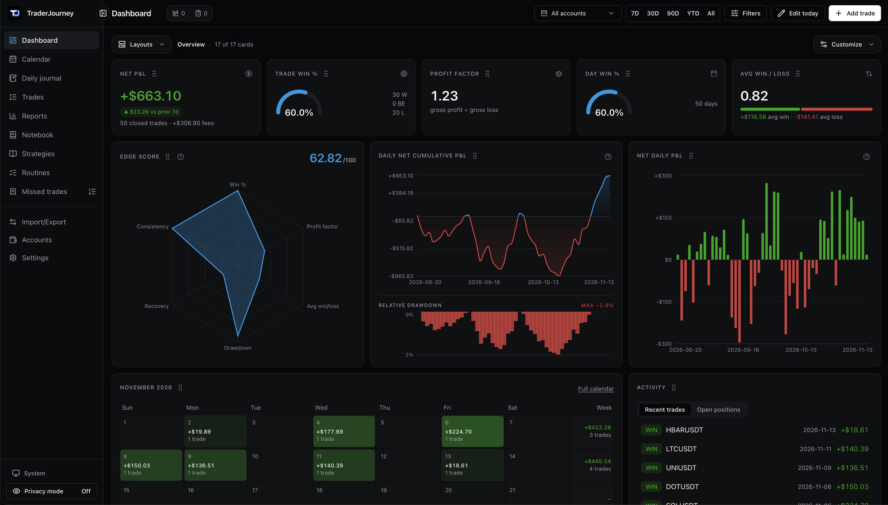
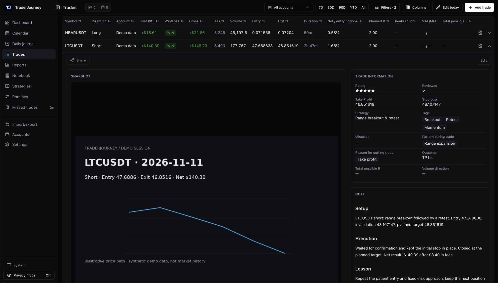
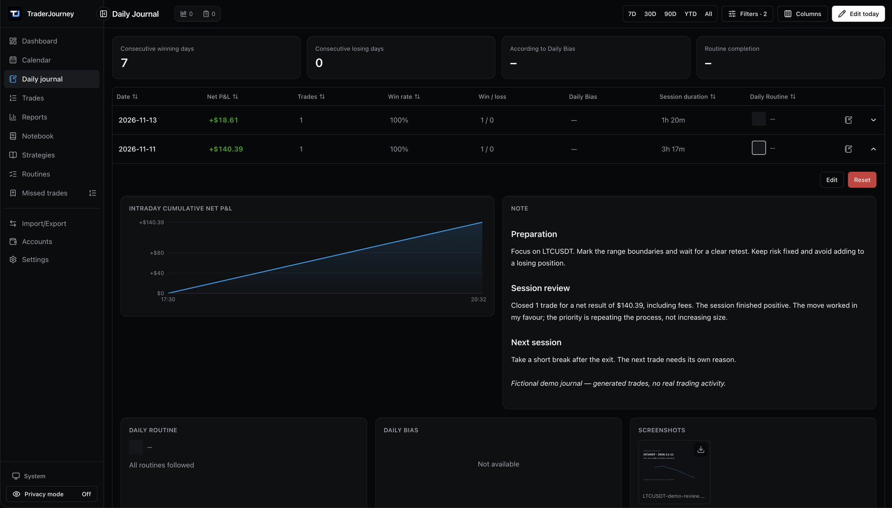

# TraderJourney

A self-hosted trading journal for reviewing trades, tracking performance and keeping a daily journal. Import broker exports, sync supported accounts or enter trades manually. Your journal is stored in a local SQLite database; optional broker and AI integrations connect to the services you configure.



## Run with Docker

Download [docker-compose.yml](docker-compose.yml), then run:

```bash
docker compose up -d
```

Open **http://localhost:3000**. Compose uses `ghcr.io/snailboob/traderjourney:latest`. Data persists in `./data`; keep this directory when upgrading.

Set a password in **Settings → Security** before exposing the app beyond your own device. Alternatively, configure `JOURNAL_PASSWORD` in Compose; it takes precedence over the password set in the app. Use HTTPS when accessing the journal over a network.

## Features

- Trade imports, manual entries and broker sync, with notes, charts and strategy reviews.
- Performance reports, equity curves, drawdowns, R multiples and a P&L calendar.
- Daily preparation and reflection, account management and prop firm tracking.
- Optional MCP tools for reviewing trades in your AI assistant and saving weekly reviews to Notes.
- Portable backup and restore in Import/Export. Installation passwords and MCP connections are excluded from these backups; preserve the data directory and any configured `JOURNAL_SECRET` separately.

## Connect an MCP client to your journal

MCP is off by default. Set an installation password in **Settings → Security**, then
open **Settings → MCP** to create or revoke a connection. Read gives access to trades
and journal notes, and list text templates. Read/Write also lets your assistant add a new weekly review after
you approve the draft; the first save creates **Notes → Weekly AI reviews**. Neither
option can edit existing notes, modify trades or place orders. Use **Open MCP guide**
in Settings, or call `get_mcp_guide` from your connected assistant for the workflow.

Read/Write can also create templates for the editor’s **Insert template** menu. It
cannot edit or delete existing templates. You can create up to five connections in
Settings. Use the switch next to a connection to pause it without replacing its
token. The **MCP** switch below Privacy mode pauses all MCP access, including the
server-managed token, without changing individual connection settings.

Settings shows a token once. Open **Setup prompt** under the connection for help
configuring your client. The prompt includes your server URL, not the token.
Enter the token in your client's secure settings, not in chat. Use HTTPS outside
a trusted private network.

For server-managed read-only access, generate a separate token with
`openssl rand -hex 32`. Store it as `JOURNAL_MCP_TOKEN` in your private Docker Compose
`.env` (the supplied Compose file passes it to the container) or in the TraderJourney
server environment. Recreate the Compose container with `docker compose up -d`, or
restart your server process, to load the new value. Remove the token and reload the
server environment to remove this legacy access. Do not use your installation password as the token.

In your client, add `/api/mcp` on your TraderJourney server as a **Streamable HTTP**
endpoint and configure the same token as a **Bearer token**. Use a loopback URL
only if the MCP client runs on the same host. Ask your assistant to retrieve the
TraderJourney MCP guide to check the connection. Data read by your assistant can
be sent to its model provider. Don't commit the token, and keep the `.env` private.

## Screenshots

Screenshots use fictional crypto trades.

### Trades



### Daily journal



### Reports


## Development

Requires Node.js 22 and pnpm 11.0.8.

```bash
git clone https://github.com/snailBoob/traderjourney.git
cd traderjourney
pnpm install --frozen-lockfile
pnpm dev
```

Run `pnpm test` and `pnpm typecheck` for checks, or `pnpm build` for a production build. The web app lives in `apps/web`; `packages/core` and `packages/importers` are private workspace packages.

[Importer formats](docs/importers.md) · [Edge Score](docs/edge-score.md) · [Security](SECURITY.md)

## License

[MIT](LICENSE). Derived from LuxAlgo's Trade Journal. Original copyright and third-party license notices are retained.
