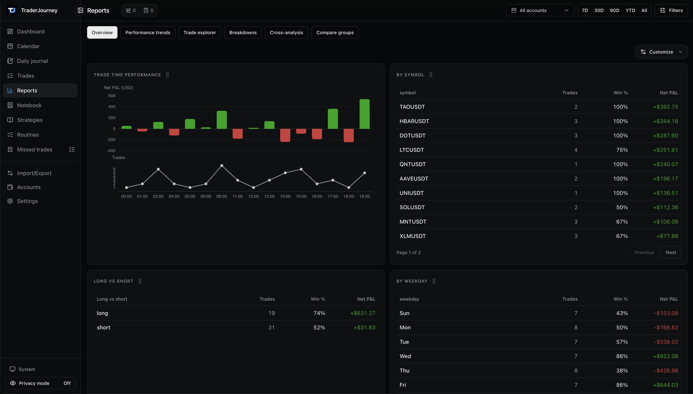

# TraderJourney

A self-hosted trading journal for reviewing trades, tracking performance and keeping a daily journal. Import broker exports, sync supported accounts or enter trades manually. Your journal is stored in a local SQLite database; optional broker and AI integrations connect to the services you configure.


## Run with Docker

Download [docker-compose.yml](docker-compose.yml), then run:

```bash
docker compose up -d
```

Open **http://localhost:3000**. The image is `ghcr.io/snailboob/traderjourney:1.0.0`. Data persists in `./data`; keep this directory when upgrading.

Set a password in **Settings → Security** before exposing the app beyond your own device. Alternatively, configure `JOURNAL_PASSWORD` in Compose; it takes precedence over the password set in the app. Use HTTPS when accessing the journal over a network.

## Features

- Trade imports, manual entries and broker sync, with notes, charts and strategy reviews.
- Performance reports, equity curves, drawdowns, R multiples and a P&L calendar.
- Daily preparation and reflection, account management and prop firm tracking.
- Optional AI-assisted reviews using your own provider configuration.
- Portable backup and restore in Import/Export. Installation passwords are excluded from these backups; preserve the data directory and any configured `JOURNAL_SECRET` separately.

## Screenshots

Screenshots use fictional crypto trades.

### Trades


### Daily journal


### Reports



## Development

Requires Node.js 22 and pnpm 11.0.8.

```bash
git clone https://github.com/snailBoob/traderjourney.git
cd traderjourney
pnpm install --frozen-lockfile
pnpm dev
```

Run `pnpm test` and `pnpm typecheck` for checks, or `pnpm build` for a production build. The web app lives in `apps/web`; `packages/core` and `packages/importers` are private workspace packages.

[Importer formats](docs/importers.md) · [Edge Score](docs/edge-score.md) · [Security](SECURITY.md)

## License

[MIT](LICENSE). Derived from LuxAlgo's Trade Journal. Original copyright and third-party license notices are retained.
